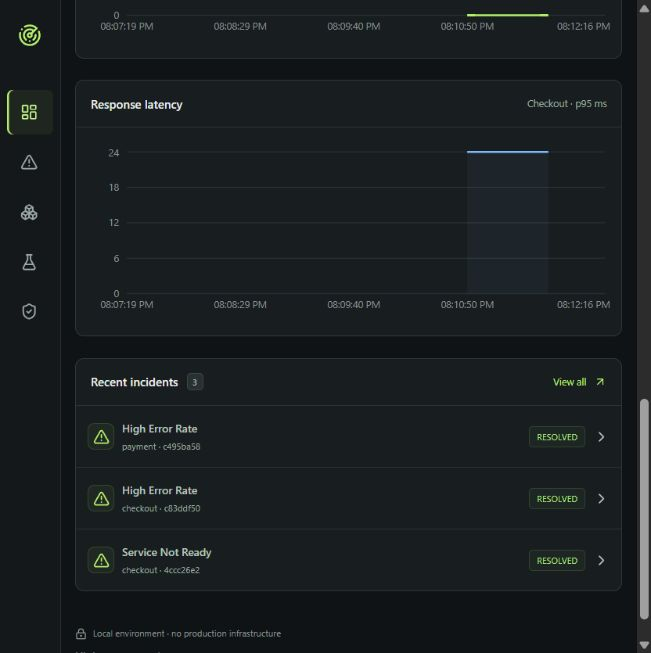

# Cloud Detective AI

Cloud Detective AI is a local incident investigation platform that turns service telemetry into evidence-backed incidents and human-approved recovery actions. It demonstrates the complete workflow—from controlled failure and diagnosis to independent recovery verification—with a React dashboard and an optional local language model. Built as a learning and portfolio project, it operates on disposable demo services rather than production infrastructure.

## Key features

- Detect sustained failures using health checks and Prometheus metrics, with incident deduplication and cooldowns.
- Preserve observations, bounded logs, correlated OpenTelemetry traces and incident timelines in PostgreSQL.
- Produce deterministic diagnoses by default; optionally add schema-validated, evidence-citing Ollama explanations with fallback.
- Separate investigation and approval roles through local accounts or generated demo credentials.
- Bind approvals to a specific action and service revision; prevent duplicate execution through conditional database transitions.
- Verify recovery with three fresh business requests, readiness checks, latency and error-counter deltas.
- Demonstrate failure disabling, health verification, controlled process restart and rollback between bundled demo behaviors.
- Inspect service metrics in provisioned Grafana dashboards and test database-outage recovery.

## Tech stack

**Frontend:** React 19, TypeScript, Vite, Recharts, Nginx.

**Backend:** Python 3.12, FastAPI, SQLAlchemy, Alembic, PostgreSQL 17.

**Observability:** Prometheus, Grafana, OpenTelemetry.

**Tooling:** Docker Compose, pytest, Ruff, ESLint, GitHub Actions; optional Ollama.

## Screenshots

Add your own screenshots before sharing the repository on your CV. Check that access tokens, passwords and personal information are not visible.

- **Dashboard overview:** screenshot placeholder.
- **Incident investigation and evidence:** screenshot placeholder.
- **Approved recovery and verification results:** screenshot placeholder.

<!-- Replace a placeholder with, for example:

Existing local screenshots are retained in docs/screenshots for optional review/use.
-->

## Setup and run

### 1. Install prerequisites

- Docker Desktop with Linux containers, or Docker Engine with the Compose plugin.
- Python 3.12 for environment setup and optional backend tests.
- Git to clone the published repository.
- Node.js 22 and npm only if running frontend development checks outside Docker.

The default demo needs no cloud account, paid API, or model download. Ensure ports **5173, 8000, 8001, 9090 and 3000** are available. Docker must be running.

### 2. Get the project

Clone the repository:

```sh
git clone https://github.com/gajendra54-design/Cloud-Detective-AI.git
cd Cloud-Detective-AI
```

For a downloaded ZIP, extract it and open a terminal in the folder containing `docker-compose.yml`.

### 3. Generate local configuration

```sh
python scripts/setup_env.py
```

On systems where Python 3.12 is named `python3`, use `python3` instead. The script creates `.env` with five distinct random credentials. It preserves valid existing values and replaces empty/sample values. `.env.example` documents supported settings using placeholders; it contains no usable credentials. You do not need to copy it to run the default demo.

**Existing installations:** PostgreSQL stores its password inside the data volume. Changing `POSTGRES_PASSWORD` in `.env` alone does not rotate that password. Coordinate a database role-password change with `.env` before recreating containers; do not delete your volume to solve a credential mismatch. Back up valued data first.

### 4. Build and start

```sh
docker compose up --build -d --wait --wait-timeout 180
docker compose ps
```

First-time downloads/builds can take several minutes. Migrations and demo service registration run automatically. If image downloads fail, resolve Docker/network access and rerun the command.

Open:

- [Application dashboard](http://localhost:5173)
- [Backend API documentation](http://localhost:8000/docs)
- [Checkout demo API documentation](http://localhost:8001/docs)
- [Prometheus](http://localhost:9090)
- [Grafana](http://localhost:3000): user `admin`; use `GRAFANA_PASSWORD` from your private `.env`.

All published ports bind to loopback. Keep this demo local.

### 5. Try an incident

1. In the dashboard, open **Operator access**. Enter the investigator and approver credentials from your local `.env` in their respective fields. Credentials stay in browser-tab memory. For named users, follow [account setup](docs/accounts.md).
2. Open **Demo lab**, activate `errors`, and send five test requests.
3. Wait for sustained observations, then open the incident under **Incidents**. If the failure expires, activate it again. The UI uses bounded failures; detection is not instantaneous.
4. Select **Investigate** and review evidence. The default provider is explicitly identified as deterministic/mock analysis.
5. Select **Propose recovery**, inspect the action and approve it using the approver role.
6. Select **Execute & verify**. Inspect the fresh verification samples and timeline. A failed verification leaves the incident open; expired approvals or changed service revisions are rejected.

See the [demo script](docs/demo-script.md) and [recovery scope](docs/recovery-actions.md) for additional scenarios.

### 6. Stop and restart

```sh
docker compose down
docker compose up -d --wait
```

Stopping retains named PostgreSQL and Grafana volumes. Do not add `--volumes` if you want to keep their data. `.env`, local backups and uploads must stay private.

## Tests and development checks

Create a Python environment and install the locked development dependencies:

```sh
python -m venv .venv
```

Activate it in **PowerShell**:

```powershell
.\.venv\Scripts\Activate.ps1
```

Or in **Linux/macOS**:

```sh
source .venv/bin/activate
```

If PowerShell blocks activation, use `.venv\Scripts\python.exe` in place of `python` in the commands below; no execution-policy change is required.

```sh
python -m pip install -r requirements.lock
python -m pytest -q
python -m ruff check backend demo-services scripts
python -m ruff format --check backend demo-services scripts
npm ci --prefix frontend
npm run lint --prefix frontend
npm run build --prefix frontend
```

PowerShell users can invoke `npm.cmd` if script execution policy blocks `npm`.

With the Docker stack running, the following checks exercise real HTTP, PostgreSQL, telemetry and recovery:

```sh
python scripts/verify_stage1.py
python scripts/verify_lifecycle.py
python scripts/verify_observability.py
python scripts/verify_concurrency.py
python scripts/verify_database_restart.py
```

These scripts intentionally change demo failure modes. The database restart check briefly stops PostgreSQL and restores it in a cleanup block. Use only the local demo stack. Unit tests use isolated databases/mocked upstreams; live tests provide separate integration evidence. Results and limits are documented in [verification](docs/verification.md) and [reliability testing](docs/reliability-testing.md).

GitHub Actions is configured in `.github/workflows/ci.yml`. Its presence does not mean a remote workflow run has passed; check the Actions tab after your first push.

## Optional local AI

Install Ollama and obtain a compatible model separately. Add the following non-secret settings to `.env`, using a model actually installed on your machine:

```dotenv
AI_PROVIDER=ollama
OLLAMA_MODEL=YOUR_INSTALLED_MODEL
OLLAMA_URL=http://host.docker.internal:11434
AI_TIMEOUT_SECONDS=15
```

Recreate the backend with `docker compose up -d backend`. Host connectivity may need additional Docker configuration on Linux. Slow inference can exceed the dashboard proxy timeout even with a longer backend timeout. Keep the default deterministic mode for the simplest reproducible demo. Read [AI validation and limitations](docs/ai-validation.md); model output is an unverified explanation, not execution authority.

## Project structure

```text
backend/           FastAPI application, models, migrations and tests
frontend/          React dashboard, styles and Nginx configuration
demo-services/     Checkout/payment services and bounded failure scenarios
observability/     Prometheus, Grafana and patched PostgreSQL image configuration
scripts/           Environment setup, smoke checks and live verification
docs/              Architecture, evidence, runbooks, scans and portfolio guidance
.github/workflows/ Automated checks for GitHub Actions
docker-compose.yml Local seven-service stack
.env.example       Placeholder-only configuration reference
```

## Known limitations

- Built for learning and portfolio demonstration; **not production-ready**.
- Local authentication is not a production identity system. Read APIs are public on loopback; TLS, MFA and distributed rate limits are not implemented.
- Container scan findings remain in backend/database/monitoring images. A zero-finding frontend scan is a point-in-time result, not a security guarantee. See [security findings](docs/container-security.md).
- Rollback selects bundled demo behaviors; it does not roll back a deployed container image.
- Verification uses a short local observation window. Graceful database-outage and concurrent-request checks do not prove crash consistency, sustained capacity or distributed correctness.
- Optional model reasoning may be inaccurate despite schema and citation checks. Deterministic policy controls recovery.
- No cloud deployment, remote CI success or independent-machine validation is claimed.

## Future improvements

- Resolve remaining image findings and add ongoing dependency/image checks.
- Add sustained load, abrupt-crash and multi-worker test coverage.
- Implement narrowly scoped container-image rollback adapters.
- Integrate external identity, stronger audit storage and production access controls.
- Add a trace collector, longer recovery observation windows and broader model evaluations.
- Validate on GitHub Actions and an independent machine before exploring cloud deployment.

## Publishing and CV material

See [publishing instructions](docs/publishing.md) for the manual Git/GitHub steps, commit suggestions, repository metadata and CV bullets. See [publication security review](docs/publication-security.md) for what was checked and excluded.

## License

This project's original source is available under the [MIT License](LICENSE). Copyright (c) 2026 D.M.G.Dissanayaka. Dependencies and container images retain their respective licenses.
